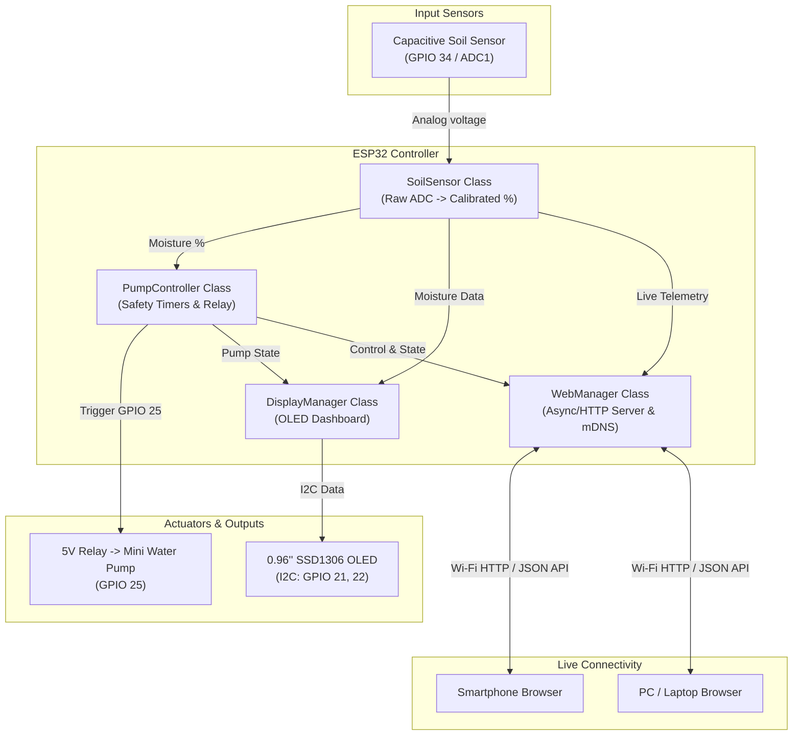

# 🌱 Smart Plant Care & Automatic Irrigation System (ESP32)

An automated plant care and monitoring system powered by the **ESP32**. It continuously monitors soil moisture levels using a capacitive soil moisture sensor, waters your plants automatically when the soil is dry, displays status on an OLED screen, and provides a **live Web Dashboard** accessible over your local Wi-Fi network.

---

## 📑 Table of Contents
- [Features](#-features)
- [Hardware Components](#-hardware-components)
- [Pinout & Wiring Guide](#-pinout--wiring-guide)
- [System Architecture](#-system-architecture)
- [Sensor Calibration](#-sensor-calibration)
- [Wi-Fi & Web Dashboard](#-wi-fi--web-dashboard)
- [Installation & Setup](#-installation--setup)
- [Configuration](#-configuration)
- [Troubleshooting](#-troubleshooting)

---

## ✨ Features
- **Capacitive Soil Moisture Sensing:** Corrosion-resistant analog moisture readings with software calibration.
- **Automated Smart Watering:** Triggers a mini water pump when soil moisture drops below a configurable threshold.
- **Non-blocking & Safety Cooldown:** Prevents soil oversaturation and pump burn-out with run duration limits and cooldown timers.
- **Live Local Web Dashboard:** 
  - Real-time moisture percentage, pump status, and raw ADC reading.
  - Manual **"Water Now"** button from any phone or computer browser on your Wi-Fi.
  - Adjustable dry moisture threshold and Auto-Watering toggle directly from the browser.
  - Access via local IP or mDNS (`http://plantcare.local`).
- **OLED Status Display (SSD1306 128x64):** Shows current moisture, progress bar, watering status, and assigned Wi-Fi IP address (gracefully skips if display is not attached).
- **Clean Object-Oriented Architecture (OOP):** Modular, readable, and maintainable C++ codebase.

---

## 🛠 Hardware Components

| Item | Description | Quantity |
| :--- | :--- | :--- |
| **ESP32 Dev Board** | ESP32-WROOM-32 (30-pin or 38-pin) | 1 |
| **Capacitive Soil Moisture Sensor** | V1.2 (analog output, 3.3V compatible) | 1 |
| **Submersible Water Pump** | 5V DC Mini Submersible Pump | 1 |
| **Relay Module** | 5V 1-Channel Relay Module (Optocoupler isolated) | 1 |
| **Silicone Tubing** | Flexible vinyl/silicone water tube (6mm–8mm inner diameter) | 1–2 meters |
| **OLED Display (Optional)** | 0.96" SSD1306 I2C OLED (128x64) | 1 |
| **Flyback Diode (Optional)** | 1N4007 (across pump motor terminals if not using protected relay module) | 1 |
| **Power Supply** | 5V 2A USB power adapter or external 5V power supply | 1 |
| **Water Reservoir** | Any container / bottle / bucket for water storage | 1 |
| **Jumper Wires & Breadboard** | Male-to-Female & Male-to-Male DuPont cables | As needed |

---

## 🔌 Pinout & Wiring Guide

### Connection Table

| Component | Component Pin | ESP32 Pin | Notes |
| :--- | :--- | :--- | :--- |
| **Capacitive Soil Sensor** | `VCC` | `3V3` | Power sensor with 3.3V to ensure ADC compatibility |
| | `GND` | `GND` | Common ground |
| | `AOUT` / `VOUT` | `GPIO 34` | ADC1 Channel (Input only, unaffected by Wi-Fi) |
| **Relay Module (Pump)** | `VCC` | `VIN` (5V) | 5V required for relay coil |
| | `GND` | `GND` | Common ground |
| | `IN` | `GPIO 25` | Digital Output trigger |
| **OLED Display (SSD1306)** | `VCC` | `3V3` or `5V` | Most modules support 3.3V-5V |
| | `GND` | `GND` | Common ground |
| | `SCL` | `GPIO 22` | I2C Clock |
| | `SDA` | `GPIO 21` | I2C Data |

### Water Pump & Relay Circuit
```
              +5V (External / VIN)
                     |
                    [ ] NO (Normally Open)
  Relay Switch ----/
                    [ ] COM (Common)
                     |
                (+) [PUMP]
                (-)   |
                     GND
```
> [!WARNING]
> Do **NOT** power the water pump directly from the ESP32's 3.3V or GPIO pins! Inductive motor spikes can damage the microcontroller. Always power the pump from the 5V rail through the relay.

---

## 📊 System Architecture



---

## ⚖️ Sensor Calibration

Capacitive soil sensors vary slightly based on manufacturing tolerances and soil composition. Calibrate your sensor for accurate percentage readings:

1. Flash the code with default settings and open the **Serial Monitor** at **115200 baud**.
2. **Dry Reading (0%):** Hold the sensor in dry air (clean and dry). Note the raw ADC value:
   - Typically between `2800` and `3500`.
3. **Wet Reading (100%):** Dip the sensor into a glass of water up to the white guideline (do not submerge electronics above the line). Note the raw ADC value:
   - Typically between `1200` and `1600`.
4. Update these constants in `Config.h`:
   ```cpp
   const int SOIL_DRY_RAW = 3200;  // Your air reading
   const int SOIL_WET_RAW = 1400;  // Your water reading
   ```

---

## 🌐 Wi-Fi & Web Dashboard

When the ESP32 boots, it connects to your local 2.4 GHz Wi-Fi network and starts a lightweight web server.

### How to Access
1. Check the Serial Monitor or OLED display after boot to find the IP address (e.g. `http://192.168.1.50`).
2. If your local network supports mDNS, navigate directly to:
   ```text
   http://plantcare.local
   ```
3. The dashboard provides:
   - **Real-Time Moisture Gauge:** Updated dynamically via AJAX without page refreshes.
   - **Soil Condition Indicator:** Displays Dry / Normal / Wet alerts.
   - **Manual Watering Action:** One-tap button to run the pump for the preset duration safely.
   - **Live Threshold Adjuster:** Change the trigger percentage on the fly.
   - **Auto Mode Switch:** Disable automatic watering when refilling water or repotting.

---

## 📁 Project Structure

This project follows the industry-standard **PlatformIO / Embedded C++** project layout:

```text
SmartPlantCare/
├── platformio.ini              # PlatformIO environment, boards & dependency config
├── include/                    # Header files (*.h) - Architecture blueprints
│   ├── Config.h                # Pin definitions, sensor calibration & Wi-Fi settings
│   ├── DisplayManager.h        # SSD1306 OLED UI and dashboard graphics
│   ├── PumpController.h        # Safe relay activation and cooldown timers
│   ├── SoilSensor.h            # Capacitive soil sensor driver & calibration
│   └── WebManager.h            # Embedded Wi-Fi web server & REST API
├── src/                        # Implementation files (*.cpp)
│   ├── main.cpp                # Main firmware entry point (setup & loop)
│   ├── DisplayManager.cpp
│   ├── PumpController.cpp
│   ├── SoilSensor.cpp
│   └── WebManager.cpp
└── README.md
```

---

## 🚀 Installation & Setup (VS Code + PlatformIO)

### 1. Open in VS Code
1. Install **[VS Code](https://code.visualstudio.com/)**.
2. Open the Extensions view (`Ctrl+Shift+X` or `Cmd+Shift+X`) and install **PlatformIO IDE**.
3. Open this `SmartPlantCare` folder in VS Code (`File` -> `Open Folder...`).
4. PlatformIO will automatically recognize `platformio.ini` and download the ESP32 toolchains and libraries (Adafruit SSD1306 & GFX).

### 2. Configure Settings
Open `include/Config.h` to configure your Wi-Fi credentials or change pins:
```cpp
const char* WIFI_SSID     = "YOUR_WIFI_NAME";
const char* WIFI_PASSWORD = "YOUR_WIFI_PASSWORD";
```

### 3. Flash to ESP32
1. Connect your ESP32 board to your computer via USB.
2. Click the **PlatformIO Upload (`→`)** button in the bottom status bar (or run `pio run -t upload`).
3. Click the **Serial Monitor (`🔌`)** button to monitor live serial output at 115200 baud.

---

## ⚙️ Configuration Reference (`Config.h`)

| Variable | Default Value | Description |
| :--- | :--- | :--- |
| `PIN_SOIL_ADC` | `34` | Analog input pin connected to moisture sensor |
| `PIN_RELAY_PUMP` | `25` | Digital output pin connected to pump relay |
| `SOIL_DRY_RAW` | `3200` | Raw ADC value measured in dry air |
| `SOIL_WET_RAW` | `1400` | Raw ADC value measured in water |
| `DRY_THRESHOLD_PERCENT` | `30` | Moisture percentage below which watering triggers |
| `PUMP_RUN_DURATION_MS` | `2500` | Pump run time per watering cycle (2.5 seconds) |
| `WATER_COOLDOWN_MS` | `15000` | Delay after watering before another cycle is allowed |
| `MDNS_HOSTNAME` | `"plantcare"` | mDNS local domain (`plantcare.local`) |

---

## ❓ Troubleshooting

- **Sensor readings inverted (shows 100% when dry):**
  - Capacitive sensors produce *higher* analog voltages when dry and *lower* when wet. Verify `SOIL_DRY_RAW > SOIL_WET_RAW`.
- **ESP32 reboots when pump turns on:**
  - The pump motor draws high current surge. Use a separate power supply for the pump or ensure your 5V USB adapter delivers at least 2A. Place a 100uF–470uF capacitor across the 5V and GND rail if needed.
- **Wi-Fi won't connect:**
  - ESP32 only supports **2.4 GHz** Wi-Fi networks (not 5 GHz). Verify your Wi-Fi SSID and password in `Config.h`.
- **OLED shows blank screen:**
  - Verify I2C connections (SDA to GPIO 21, SCL to GPIO 22). Check I2C address (`0x3C` is standard, some displays use `0x3D`). The system will continue operating even if the OLED is disconnected.
